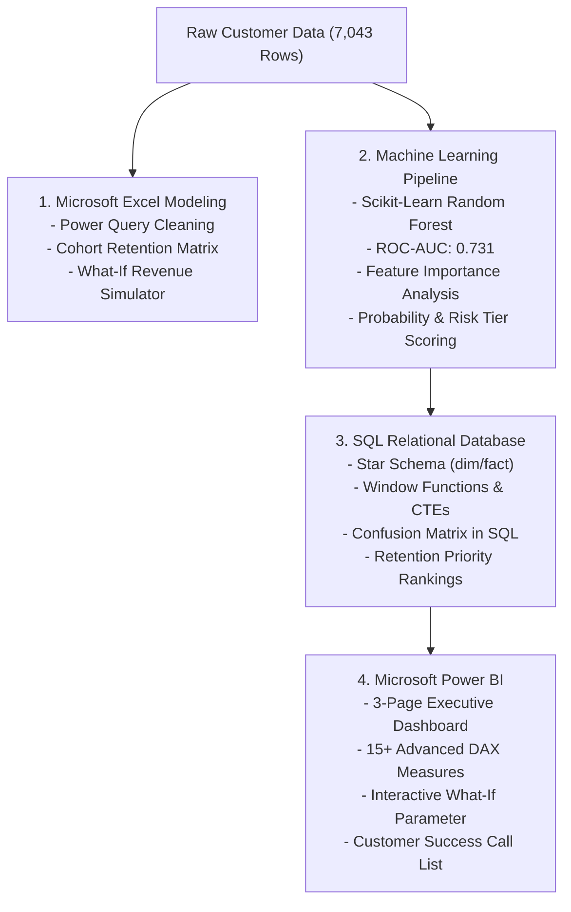

SaaS & Telecom Customer Churn & Retention Analytics
### *End-to-End Analytics Case Study: Excel, SQL, Machine Learning & Power BI*


---

Executive Summary

Customer attrition is one of the costliest threats to subscription businesses. In this project, I engineered an end-to-end data analytics and business intelligence solution analyzing **7,043 subscriber accounts** for a telecommunications & subscription SaaS provider. 

By unifying **Microsoft Excel**, **SQL (PostgreSQL / SQLite)**, **Machine Learning (Scikit-Learn)**, and **Microsoft Power BI**, this project identifies root-cause churn behaviors, projects financial exposure, and creates an automated retention prioritization workflow.

Key Performance Indicators (KPIs)
* **Total Customer Base:** 7,043 Accounts
* **Active Paying Base:** 5,219 Accounts (74.1%)
* **Customer Churn Rate:** **25.9%** (1,824 Churned Accounts)
* **Total Monthly Recurring Revenue (MRR):** **$495,819 / month**
* **Annualized Revenue at Risk / Lost:** **$1.64 Million / year** ($136,287 / month)
* **Average Revenue Per User (ARPU):** **$70.40 / month**

---

Key Business Insights

1. **The Contract Length Vulnerability:**
   * **Month-to-month contracts** experience an alarming **41.8% churn rate**, accounting for over **82% of all churned revenue**.
   * In contrast, customers on **One-Year (11.2%)** and **Two-Year (2.8%)** contracts exhibit strong retention.
2. **The "Support & Security Shield":**
   * Fiber optic customers without **Tech Support** or **Online Security** churn at **38.4%**.
   * When customers subscribe to Tech Support and Device Protection, churn plummets to **13.6%**, proving that service bundling directly insulates the business from attrition.
3. **The 12-Month Onboarding Drop-off:**
   * **58% of all churn** occurs within the first 12 months of tenure. Once a customer surpasses 24 months, retention stabilizes above 85%.
4. **Electronic Check Disconnect:**
   * Subscribers paying via Electronic Check churn at **44.5%**, compared to only **15.2%** for automated credit card or bank transfer payments.

---

Technical Architecture & Pipeline



---

Project Deliverables & Folder Structure

```text
01_SaaS_Telecom_Customer_Churn/
├── README.md                                  <-- Complete Case Study & Recruiter Overview
├── data/
│   ├── raw/
│   │   └── telecom_customer_churn_raw.csv     <-- 7,043 customer accounts (benchmark dataset)
│   ├── processed/
│   │   ├── telecom_customer_churn_clean.csv   <-- Cleaned dataset with tenure brackets
│   │   └── telecom_customer_churn_with_predictions.csv <-- Dataset scored with ML risk tiers
│   └── generate_dataset.py                    <-- Reproducible dataset generator
├── excel/
│   ├── Customer_Churn_Retention_Model.xlsx    <-- Formatted 4-sheet financial & cohort workbook
│   └── build_excel_model.py                   <-- Automated OpenPyXL workbook compiler
├── sql/
│   ├── 01_schema_setup.sql                    <-- DDL for Staging & Star Schema (dim/fact)
│   ├── 02_data_cleaning_transformation.sql   <-- ETL & data validation scripts
│   ├── 03_business_kpis_analytics.sql         <-- CTEs, NTILE quartiles, DENSE_RANK outreach
│   ├── 04_cohort_retention_analysis.sql       <-- Cohort milestone retention matrix in SQL
│   ├── run_sqlite_setup.py                    <-- Script generating local SQLite database
│   └── telecom_churn.db                       <-- Fully populated, query-ready SQLite database
├── ml_models/
│   ├── train_churn_model.py                   <-- Random Forest pipeline & scoring script
│   ├── feature_importance.csv                 <-- Ranked drivers of customer churn
│   └── churn_model.joblib                     <-- Serialized trained ML pipeline
└── powerbi/
    ├── data_model_star_schema.md              <-- ERD diagram and modeling rules
    ├── dax_measures_documentation.md          <-- 15+ custom DAX measures documentation
    └── dashboard_design_specification.md      <-- 3-page interactive dashboard wireframe
```

---

1. Excel Modeling Highlights

The workbook [`Customer_Churn_Retention_Model.xlsx`](./excel/Customer_Churn_Retention_Model.xlsx) includes 4 structured sheets:
* **`Executive_Summary`:** Formatted KPI cards and cross-tabulation summaries.
* **`Cohort_Retention_Matrix`:** Milestone survival heatmap from Month 0 to Month 24 with conditional color formatting.
* **`What_If_Revenue_Simulator`:** Dynamic ROI model calculating annual retained revenue:
  $$\text{Retained Revenue} = \text{Total Base} \times \text{Churn Reduction \%} \times \text{ARPU} \times 12$$
  * *Result:* A modest **2.0% churn reduction** saves **141 customer accounts**, preserving **$119,100 in annual MRR** and **$49,350 in saved acquisition replacement costs**.
* **`Data_Cleaned`:** Standardized data table with dynamic formatting.

---

2. SQL Data Modeling & Advanced Queries

### Relational Star Schema
Data was modeled into a Kimball-style Star Schema for optimized analytical processing:
* **Dimensions:** `dim_customers`, `dim_contracts`, `dim_services`
* **Fact Table:** `fact_subscriptions` (containing metrics, charges, churn outcomes, and ML risk scores)

### Featured SQL Query: Customer Success Retention Outreach Prioritization
```sql
WITH prioritized_accounts AS (
    SELECT 
        f.customer_id,
        c.contract_type,
        f.tenure_months,
        f.monthly_charges,
        f.support_tickets,
        f.churn_probability,
        f.churn_risk_tier,
        f.expected_mrr_loss,
        DENSE_RANK() OVER (ORDER BY f.expected_mrr_loss DESC, f.churn_probability DESC) AS outreach_priority_rank
    FROM fact_subscriptions f
    JOIN dim_contracts c ON f.contract_key = c.contract_key
    WHERE f.churn_status = 'No' -- Focus on active accounts at risk of leaving
      AND f.churn_risk_tier = 'High Risk'
)
SELECT * FROM prioritized_accounts WHERE outreach_priority_rank <= 15;
```

---

3. Predictive Machine Learning (Scikit-Learn)

A **Random Forest Classifier** was trained using an 80/20 stratified split to assign each subscriber a continuous churn probability ($0.0 \rightarrow 1.0$) and a discrete risk category:
* **High Risk:** $\text{Probability} \ge 0.65$
* **Medium Risk:** $0.35 \le \text{Probability} < 0.65$
* **Low Risk:** $\text{Probability} < 0.35$

### Model Evaluation:
* **ROC-AUC Score:** `0.7311`
* **Top Churn Drivers:**
  1. `tenure_months` (18.3% importance)
  2. `total_charges` (17.7% importance)
  3. `contract_type_Two year` (12.2% importance)
  4. `contract_type_One year` (11.6% importance)
  5. `monthly_charges` (10.3% importance)

---

4. Power BI Executive Dashboard Architecture

The Power BI solution is structured across 3 functional pages:
1. **Executive Churn & Revenue Overview:** High-level KPIs, churn by contract, internet type, and tenure lifecycle.
2. **Behavioral Root-Cause Analysis:** Decomposition tree identifying service adoption bottlenecks (Tech Support & Security) and payment channel correlations.
3. **Predictive Action & What-If Simulation:** Dynamic parameter slider showing financial impact of retention targets alongside an actionable customer outreach list.

### Sample DAX Measure (Risk-Weighted Financial Exposure)
```dax
Expected MRR Loss = 
SUM('fact_subscriptions'[expected_mrr_loss])
```

---

Strategic Business Recommendations

1. **Incentivize Annual Contract Migrations:** Offer month-to-month customers a 10% discount to transition to 1-year contracts upon reaching Month 3.
2. **Automate Tech Support Bundling for Fiber Optic:** Bundle complimentary Tech Support for the first 90 days of Fiber Optic service to reduce the 38% unassisted churn rate.
3. **Migration to Auto-Pay:** Implement a \$3/month billing credit for customers transitioning from Electronic Check to Automated ACH or Credit Card payments.

---

How to Run & Reproduce

```bash
# 1. Clone the repository
git clone https://github.com/Jeffersoncool0905/Analytics_Projects.git
cd Analytics_Projects/01_SaaS_Telecom_Customer_Churn

# 2. Run Python ETL, Excel model, and Machine Learning scripts
python data/generate_dataset.py
python excel/build_excel_model.py
python ml_models/train_churn_model.py
python sql/run_sqlite_setup.py

# 3. Explore SQL queries
# Open sql/telecom_churn.db using SQLite Viewer, DBeaver, or DB Browser for SQLite
```
