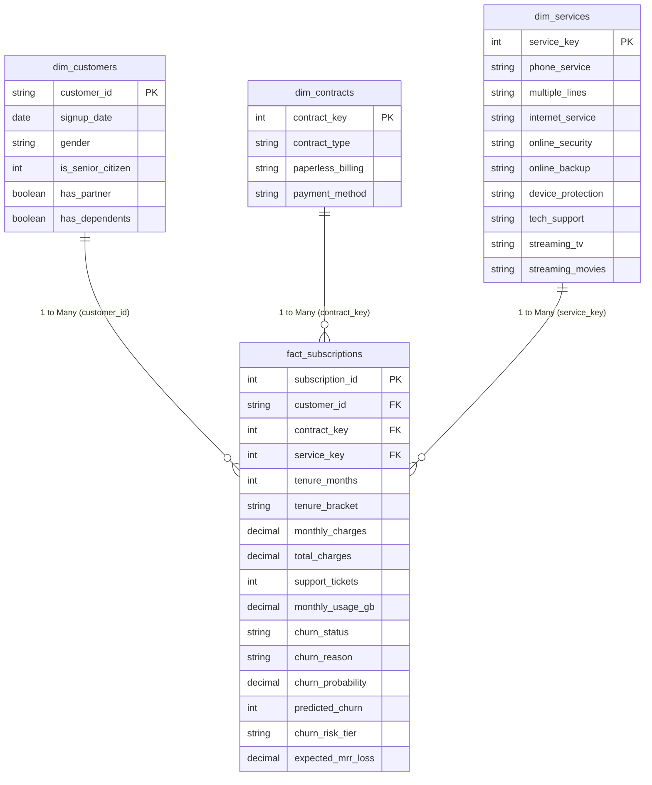

This document outlines the relational data modeling approach applied in Power BI. A **Star Schema** architecture is implemented to ensure fast query performance, simplified DAX calculations, and intuitive report authoring.

---

## 1. Entity-Relationship Diagram (ERD)

---

 2. Model Guidelines & Best Practices

1. **Cardinality & Cross-Filtering:**
   * All relationships are strictly `1:*` (One-to-Many).
   * Cross-filter direction is set to **Single** (from dimension to fact table) to avoid circular dependencies and performance degradation.
2. **Key Hiding:**
   * Foreign keys in `fact_subscriptions` (`contract_key`, `service_key`, `customer_id`) are **hidden** in Report View to prevent users from accidentally creating invalid aggregations.
3. **Dedicated Measure Table:**
   * An empty calculation table `_AllMeasures` is created to store all DAX measures in organized folders:
     * `01 Volume & Counts`
     * `02 Rates & Ratios`
     * `03 Revenue & CLV`
     * `04 Predictive Risk`
     * `05 What-If Simulator`
