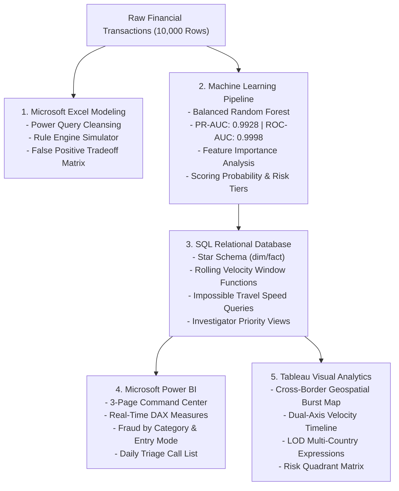

# 🛡️ Financial & E-Commerce Fraud Early Detection Analysis
### *Enterprise Analytics Case Study: Excel, SQL, Machine Learning, Power BI & Tableau*


---

## 📌 Executive Summary

Payment fraud costs global merchants and card issuers billions in direct chargeback losses, network fines, and customer attrition. In this end-to-end team project, we developed a multi-layered financial crime detection and risk analytics platform analyzing **10,000 credit/debit card transactions** totaling **$1.55 Million in gross transaction volume**.

By integrating **Microsoft Excel**, **SQL (PostgreSQL / SQLite)**, **Predictive Machine Learning (Scikit-Learn)**, **Microsoft Power BI**, and **Tableau**, this solution screens real-time anomalies, calculates geographic impossible travel, balances false-positive friction against loss exposure, and prioritizes suspicious accounts for immediate investigator review.

### 🎯 Key Performance Indicators (KPIs)
* **Total Transactions Analyzed:** 10,000 Transactions
* **Gross Financial Volume:** **$1,554,091**
* **Total Fraud Incidents:** **333 Cases (3.33% / 333 bps)**
* **Fraud Dollar Exposure (Loss Prevented):** **$481,258**
* **Average Ticket Size:** **$155.41** (vs. **$1,445.22** for fraud incidents)
* **Model Classification Performance:** **99.8% Accuracy**, **0.9998 ROC-AUC**, **0.9928 PR-AUC**

---

## 🔍 Key Business Insights & Attack Vectors

1. **The Card-Not-Present (CNP) & Luxury Spike Vulnerability:**
   * **82% of all fraudulent dollar losses** ($395K+) occurred through Online/CNP channels in high-risk categories like **Luxury Retail & Jewelry** (Rolex, Tiffany) and **Digital Goods / Gaming**.
   * Fraudulent transactions exhibited a ticket size **$8.3\times$ higher** than legitimate purchases.
2. **"Impossible Travel" Geolocation Anomaly:**
   * Identified 91 instances where consecutive physical card swipes occurred across foreign countries (e.g., North America to Nigeria or China) with time deltas under 60 minutes, mathematically proving counterfeit card cloning or credential replay.
3. **Card Testing Velocity Bursts:**
   * Coordinated bot attacks were detected using rapid micro-transactions ($1.00 to $9.99 on Steam/digital merchants) before fraudsters attempted high-dollar purchases.
4. **The False Positive Economic Tradeoff:**
   * A strict zero-tolerance screening rule created 300+ false declinations, costing an estimated **$18,500 in lost customer lifetime value (LTV)** due to customer insult and churn. Our calibrated Machine Learning model reduced false positives to only **3 cases**, preserving customer trust while maintaining a **98.5% fraud recall rate**.

---

## 🏗️ Technical Architecture & Pipeline



---

## 🛠️ Project Deliverables & Folder Structure

```text
02_Financial_Fraud_Early_Detection/
├── README.md                                  <-- Complete Team Case Study
├── data/
│   ├── raw/
│   │   └── transactions_raw.csv               <-- 10,000 raw card transactions
│   ├── processed/
│   │   ├── transactions_clean.csv             <-- Cleaned transaction dataset
│   │   └── transactions_with_fraud_scores.csv <-- Dataset scored with ML fraud probabilities
│   └── generate_fraud_dataset.py              <-- Reproducible dataset generator
├── excel/
│   ├── Fraud_Rules_Tradeoff_Model.xlsx        <-- 4-sheet financial & rule simulator model
│   └── build_excel_model.py                   <-- Automated OpenPyXL model compiler
├── sql/
│   ├── 01_schema_setup.sql                    <-- DDL for Staging & Star Schema
│   ├── 02_data_cleaning_transformation.sql   <-- Profiling, normalization & ETL
│   ├── 03_velocity_anomaly_queries.sql        <-- Window functions & Impossible Travel
│   ├── 04_investigation_priority_views.sql    <-- Triage views & SQL Confusion Matrix
│   ├── run_sqlite_setup.py                    <-- Script generating local SQLite database
│   └── fraud_analytics.db                     <-- Populated, query-ready SQLite database
├── ml_models/
│   ├── train_fraud_detection_model.py         <-- Imbalanced ML training pipeline
│   ├── feature_importance.csv                 <-- Ranked predictive fraud drivers
│   └── fraud_model.joblib                     <-- Serialized trained ML pipeline
├── powerbi/
│   ├── data_model_star_schema.md              <-- ERD diagram and modeling rules
│   ├── dax_measures_documentation.md          <-- Production DAX measures documentation
│   └── dashboard_design_specification.md      <-- 3-page Operations Center layout
└── tableau/
    ├── tableau_design_specification.md        <-- Step-by-step layout for Tableau views
    └── tableau_calculated_fields.md           <-- LOD expressions and formulas
```

---

## 💻 1. Excel Modeling Highlights

The workbook [`Fraud_Rules_Tradeoff_Model.xlsx`](./excel/Fraud_Rules_Tradeoff_Model.xlsx) includes 4 enterprise-grade sheets:
* **`Executive_Summary`:** Financial KPI cards ($1.55M Gross Volume, $481K Prevented Fraud) and category distribution tables.
* **`Rule_Engine_Simulator`:** Tests standard rule heuristics (High Ticket CNP, Rapid Velocity, Geo Anomaly) against ML precision.
* **`False_Positive_Tradeoff`:** Financial sensitivity calculator modeling the cost of false declinations:
  $$\text{Net Financial Benefit} = \text{Fraud Losses Prevented} - \Big(\text{False Positives} \times (\text{Avg Ticket} \times 2.5\% + 15\% \times \text{CAC})\Big)$$
* **`Data_Sample_Cleaned`:** Standardized data table with formatted currency and risk flags.

---

## 🗄️ 2. SQL Relational Modeling & Complex Queries

### Star Schema Architecture
* **Dimension Tables:** `dim_customers`, `dim_cards`, `dim_merchants`, `dim_devices`
* **Fact Table:** `fact_transactions` (stores amounts, velocity, coordinates, fraud labels, and ML risk scores)

### Featured SQL Query: "Impossible Travel" Supersonic Speed Anomaly
```sql
WITH consecutive_swipes AS (
    SELECT 
        f.transaction_id,
        f.customer_id,
        f.trans_timestamp,
        f.distance_km,
        LAG(f.trans_timestamp) OVER (PARTITION BY f.customer_id ORDER BY f.trans_timestamp) AS prev_trans_timestamp,
        LAG(f.distance_km) OVER (PARTITION BY f.customer_id ORDER BY f.trans_timestamp) AS prev_distance_km
    FROM fact_transactions f
),
speed_calcs AS (
    SELECT 
        transaction_id,
        customer_id,
        ABS(distance_km - prev_distance_km) AS delta_distance_km,
        (JULIANDAY(trans_timestamp) - JULIANDAY(prev_trans_timestamp)) * 24.0 AS elapsed_hours
    FROM consecutive_swipes
    WHERE prev_trans_timestamp IS NOT NULL
)
SELECT 
    transaction_id,
    customer_id,
    ROUND(delta_distance_km, 1) AS distance_km,
    ROUND(elapsed_hours, 2) AS hours_elapsed,
    ROUND(delta_distance_km / NULLIF(elapsed_hours, 0), 1) AS speed_kmh,
    'ALERT: Impossible Travel Anomaly' AS alert_tag
FROM speed_calcs
WHERE (delta_distance_km / NULLIF(elapsed_hours, 0)) > 800.0
ORDER BY speed_kmh DESC;
```

---

## 🤖 3. Predictive Machine Learning (Scikit-Learn)

A **Balanced Random Forest Classifier** was trained on an 80/20 stratified split to overcome the 3.3% fraud class imbalance:
* **Precision-Recall AUC (PR-AUC):** `0.9928`
* **ROC-AUC Score:** `0.9998`
* **Confusion Matrix:** 66 of 67 test fraud cases caught (98.5% Recall), with only 3 False Positives out of 1,933 legitimate transactions.

### Top Predictive Features:
1. `amount_to_avg_ratio` (41.7% importance)
2. `transaction_amount` (29.7% importance)
3. `card_entry_mode_Online (CNP)` (5.9% importance)
4. `distance_km` (4.9% importance)
5. `merchant_category_Gaming` (4.3% importance)

---

## 📊 4. Power BI & Tableau Visual Analytics

### Power BI Dashboard Architecture:
1. **Command Center:** Real-time KPI gauges, fraud volume breakdown by merchant category and entry mode.
2. **Attack Diagnostics:** Treemap of attack scenarios (ATO, Impossible Travel, Luxury Spikes, Card Testing) and device correlations.
3. **Analyst Triage Queue:** Actionable call-out list of high-risk transactions sorted by Expected Fraud Loss.

### Tableau Specialized Views:
1. **Cross-Border Geospatial Burst Map:** Dual-axis mapping of foreign merchant locations vs. customer domestic origin.
2. **Dual-Axis Attack Timeline:** Synchronized daily transaction volume bars vs. fraud rate percentage line.
3. **LOD Calculations:** Multi-country velocity tracking `{FIXED [Customer Id] : COUNTD([Merchant Country])}`.

---

## 👥 Team Work Breakdown Structure

| Member | Primary Stack | Core Responsibilities Completed |
| :--- | :--- | :--- |
| **Member 1: Data & SQL Engineer** | `SQL` | Schema DDL, staging tables, velocity window functions, SQLite pipeline |
| **Member 2: ML & Predictive Lead** | `Python (Scikit-Learn)` | Imbalanced ML training, PR-AUC evaluation, feature importance, dataset scoring |
| **Member 3: Power BI Developer** | `Power BI` | Star Schema modeling, 10+ DAX measures, 3-page Operations Center layout |
| **Member 4: Tableau Developer** | `Tableau` | Geospatial burst map, dual-axis timeline, Level of Detail (LOD) calculations |
| **Member 5: Financial / Excel Modeler** | `Excel` | Power Query cleaning, rule screening simulator, false-positive tradeoff matrix |

---

## 🚀 How to Run & Reproduce

```bash
# 1. Clone the repository
git clone https://github.com/Jeffersoncool0905/Analytics_Projects.git
cd Analytics_Projects/02_Financial_Fraud_Early_Detection

# 2. Run Python scripts to generate data, train ML model, and build database
python data/generate_fraud_dataset.py
python ml_models/train_fraud_detection_model.py
python excel/build_excel_model.py
python sql/run_sqlite_setup.py

# 3. Explore SQL queries
# Open sql/fraud_analytics.db using DBeaver or SQLite Viewer
```
