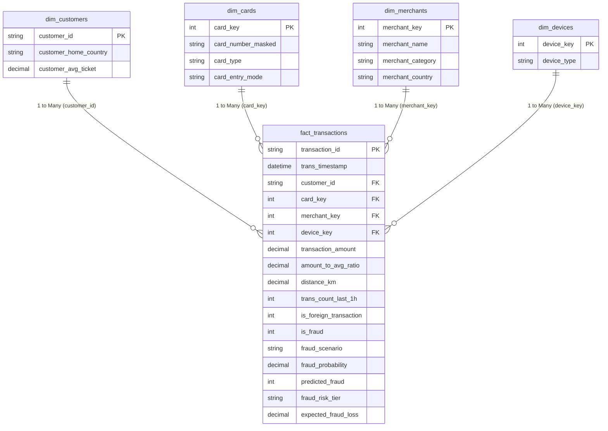

# 🌟 Power BI Data Model Architecture (Star Schema)

This document defines the Star Schema relational data model designed for the **Financial Fraud Early Detection Operations Dashboard** in Power BI Desktop.

---

## 1. Entity-Relationship Diagram (ERD)

---

## 2. Cardinality & Cross-Filtering Best Practices
* **Relationship Type:** Strictly `1:*` (One-to-Many).
* **Cross-filter direction:** **Single** (Dimension filters Fact table).
* **Foreign Keys:** Hidden from Report View in `fact_transactions` to avoid accidental end-user aggregations.
* **Calculation Table:** Measures grouped into dedicated folders inside `_AllMeasures`.
